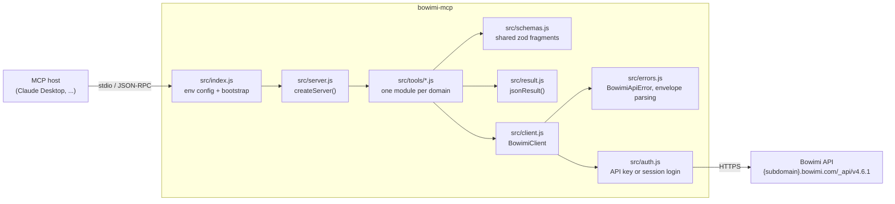

# Architecture

`bowimi-mcp` is a stdio [Model Context Protocol](https://modelcontextprotocol.io) server that exposes the Bowimi field-sales CRM API as 85 tools. It is a thin, stateless adapter: every tool call maps to one or a few Bowimi HTTP requests, and results are returned to the model as pretty-printed JSON.

## Modules

| Path | Responsibility |
|------|----------------|
| `src/index.js` | Reads `BOWIMI_*` env vars, builds auth + client, starts the stdio transport. The only module with side effects. |
| `src/server.js` | `createServer({ client, auth, version })`: creates the `McpServer` and calls every tool module's `register*Tools`. No I/O, so tests can inject a mock client. |
| `src/tools/*.js` | Tool definitions grouped by domain: `account`, `tags`, `attributes`, `locations`, `companies`, `tasks`, `orders`, `products`, `surveys`, `route`, `analytics` (composite reports), `debug`. Each tool = name, description, zod input shape, handler. |
| `src/schemas.js` | Zod fragments shared verbatim by many tools (pagination `offset` / `limit`). |
| `src/result.js` | `jsonResult(data)`: the standard text result. |
| `src/client.js` | `BowimiClient`: one method per endpoint. Wraps Bowimi's non-standard `QUERY` and `LIST` HTTP verbs alongside `GET/POST/PATCH/DELETE`. |
| `src/errors.js` | Maps non-2xx responses to `BowimiApiError` (`Bowimi API <path> → <status>: <ErrorType>: <Message>`) and unwraps the `{ Data }` success envelope. |
| `src/auth.js` | Static API key (preferred) or email/password session with cookie jar and token refresh. |

## Error handling

Tool handlers do not catch API errors. `BowimiClient` throws a `BowimiApiError`; the MCP SDK converts any thrown error into a tool result with `isError: true` and the message as text. The message never includes a stack trace, so the model sees the HTTP status and Bowimi's own `ErrorType: Message`. Composite tools (for example `get_team_overview`) tolerate per-item failures with `.catch(() => null)` so one failing rep does not fail the whole report.

## Adding a tool

1. Add the endpoint method to `BowimiClient` (`src/client.js`).
2. Register the tool in the matching `src/tools/<domain>.js` module.
3. Add the name to `EXPECTED_TOOLS` in `test/server.test.js` and document it in `docs/TOOLS.md`.
4. Run `npm run check` (type check + tests). Tests never hit the network: client tests mock `fetch`, server tests inject a mock client.
